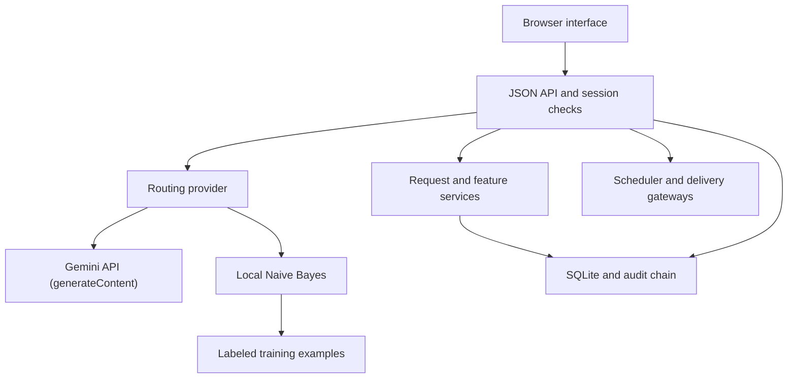
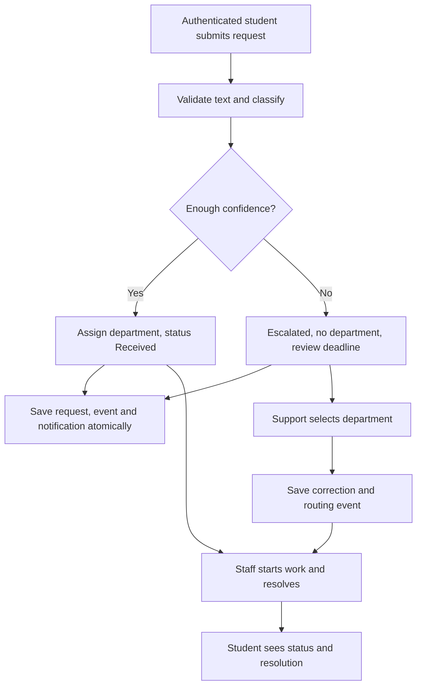
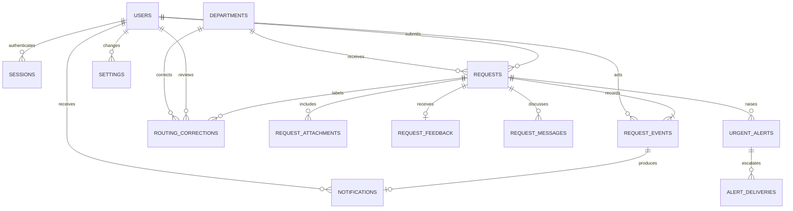
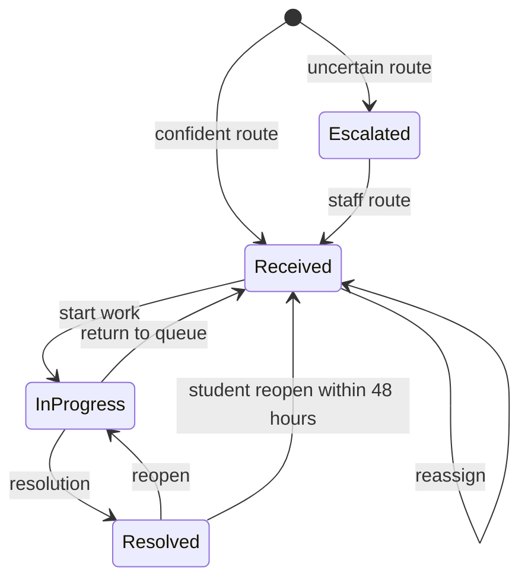

# Design and architecture

## Component responsibilities

The browser renders student, support, and administrator workspaces. `Application` serves static files, validates JSON, checks sessions/CSRF, and enforces role boundaries. Classification happens before opening the write transaction; the service saves routing, event history, notifications, and audit entries atomically. Feature modules handle analytics, SLA calendars, attachments, privacy jobs, and audit search. The scheduler runs alert escalation, SLA reminders, retention anonymization, and periodic local-model retraining.

## Request flow

## ER diagram

## Data dictionary

| Entity | Important fields | Purpose |
| --- | --- | --- |
| users | name, unique email, password_hash, role | Student/support/admin identities |
| sessions | token_hash, nullable user_id, csrf_token, expires_at | Anonymous/authenticated sessions; cookie token hashed in DB |
| departments | code, name, response_hours | Configured destinations and adjustable first-response targets |
| requests | student_id, original message, department_id, confidence, classification_json, status, priority, version, timestamps, review_due_at, sla_due_at, anonymized_at | Request, current route, and business-time deadlines |
| request_events | request_id, actor_id, kind, status, detail, version, created_at | Student-visible chronological history |
| notifications | user_id, request_id, unique event_id, message, read_at | One in-app notice per event |
| routing_corrections | request_id, staff_id, original/corrected code, confidence, message_snapshot, reason | Labels for future retraining |
| settings | key, value, updated_by, updated_at | Persisted confidence threshold |
| request_feedback | request_id, department_id, rating, comment | One post-resolution student rating per request |
| request_attachments | request_id, name, MIME type, length, SHA-256, content | Small private files stored in SQLite and downloaded through authorization checks |
| request_messages | request_id, sender, role, body, read_at | Student/support message thread; text is excluded from AI calls |
| urgent_alerts / alert_deliveries | request_id, contact level, channel, target, delivery status | On-call escalation with unique per-level/channel delivery attempts |
| staff_notifications | user_id, request_id, kind, message, read_at | Private SLA and reopen reminders for support staff |
| school_holidays | day, label | Admin-managed excluded dates for business-time calculations |
| audit_log | request_ref, actor, action, old/new values, prev_hash, entry_hash | Request references and metadata only; immutable application triggers plus SHA-256 chaining |
| deletion_requests | user_id, status, decision actor/time | Student data-deletion request and administrator decision history |

The SQLite schema enforces status/priority enums, foreign keys, and append-only audit triggers. An escalated request has no department; every other status has an assigned department. Student deletion before work begins removes the request row and its related data while leaving the independent audit reference. Retention anonymization replaces old free text and attachments while keeping category, department, and timing metrics.

## State transitions

The API serializes `InProgress` as `In Progress`. Editing a request before work starts runs classification again; it can move between Received and Escalated. A resolved request cannot be rerouted until reopened. Student edit/delete is allowed only before staff starts work.

## Concurrency and consistency

For request creation/editing, authentication, input validation and AI classification run first. External HTTP work never holds the SQLite write lock. The API then begins `BEGIN IMMEDIATE`, rechecks the session, and reads the current request/version again before writing. Other mutations also begin the write transaction before final version checks. A client supplies the last seen request `version`; a stale version produces HTTP 409. This avoids overwriting another staff decision. Events and notifications are saved in the same transaction as the updated request. The event uniqueness constraint and notification's unique `event_id` prevent duplicate event receipts. Refreshing is read-only.

## UI/UX plan

| Screen | Structure and user action |
| --- | --- |
| Sign-in/registration | Intro panel, labeled form, validation error, switch to student registration |
| Student workspace | Sidebar, account header, request counts, intake form, own request list |
| Request detail | Original text, current route/status, timestamps, resolution, timeline, early edit/delete |
| Notification history | Chronological receipts, response estimates, read markers |
| Support queue | Status/department/priority filters, oldest-first cards, confidence, direct route selector/button |
| Administrator | Routing threshold, retraining, analytics, on-call contacts, SLA calendar, retention/deletion, and audit search/export |

The functional screens serve as executable wireframes. Captured previews and actual browser-check status, when available, live in `docs/evidence/`. `static/style.css` defines the shared colors, cards, typography, responsive breakpoints, and focus states.

## Deployment boundary

`wsgiref` is a local development server, with a thread-per-request wrapper. The default host is loopback. Optional SMTP email is disabled unless configured. Use a production WSGI server, HTTPS, identity verification, backups, managed secrets, and institution-approved data handling before collecting real student requests.

## Provider configuration

`app/llm.py` calls the fixed HTTPS Gemini `generateContent` endpoint with a server-only `x-goog-api-key` header and a JSON response schema for classification, language, and translation. `app/config.py` reads only allowed settings without evaluation and respects existing environment variables. `setup_gemini_windows.bat` writes local `.env`; no credentials are committed. `--ai local` forces offline mode. Review fallback has confidence zero and no assigned department. Translation is available only when Gemini is configured; offline routing uses a small Russian/Kazakh support vocabulary. See `ai_explanation.md` and `../API_START_RU.md`.

## SDU identity policy

`app/university.py` owns the exact nine-digit student-address rule and academic-year computation. Public registration applies this policy on the server before inserting a student. Profile metadata is derived when returning users, so course is not a stale database column. US12 renders the current account and derived academic metadata on the student-only `/profile` page. No profile table or schema migration is needed. The requested helpdesk address is provisioned with a support role; public signup cannot create staff. Known old demo identities migrate in place, preserving IDs and request ownership. Mailbox control and official enrollment are not verified; see `SDU_REGISTRATION.md`.
