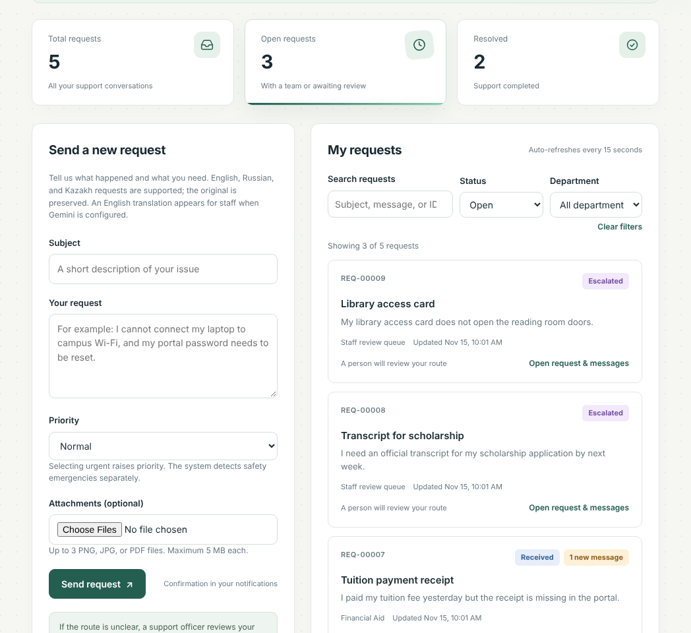
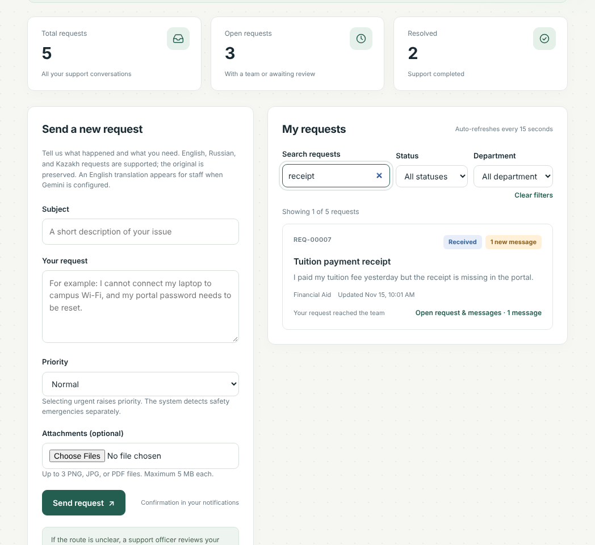
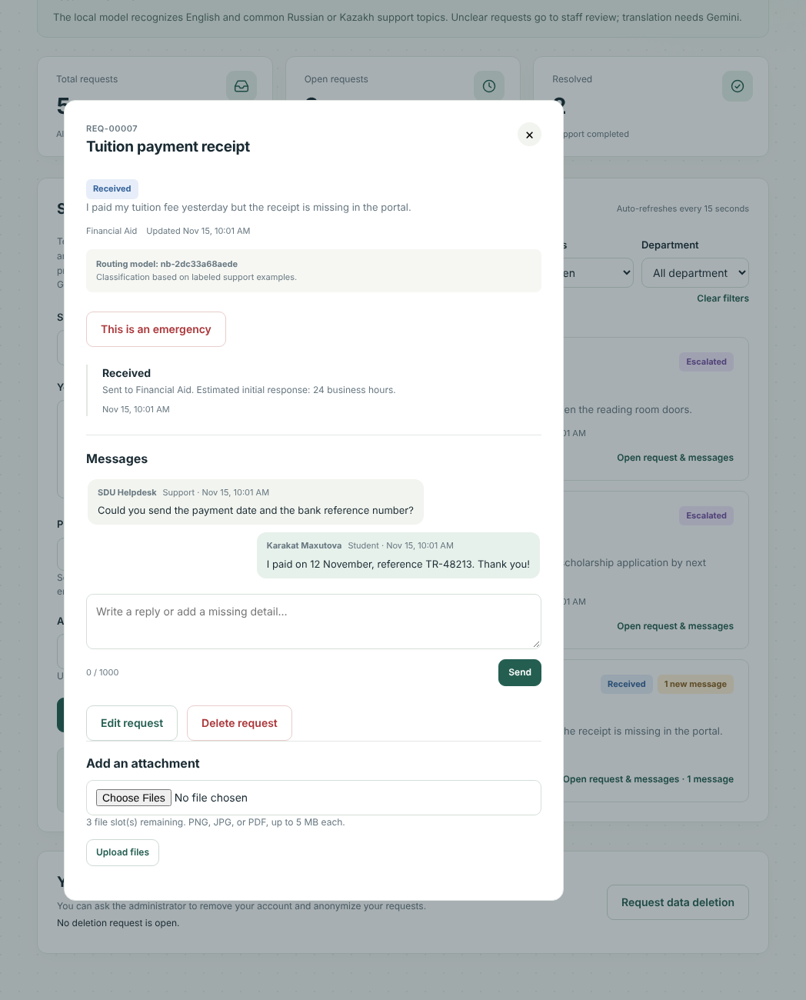
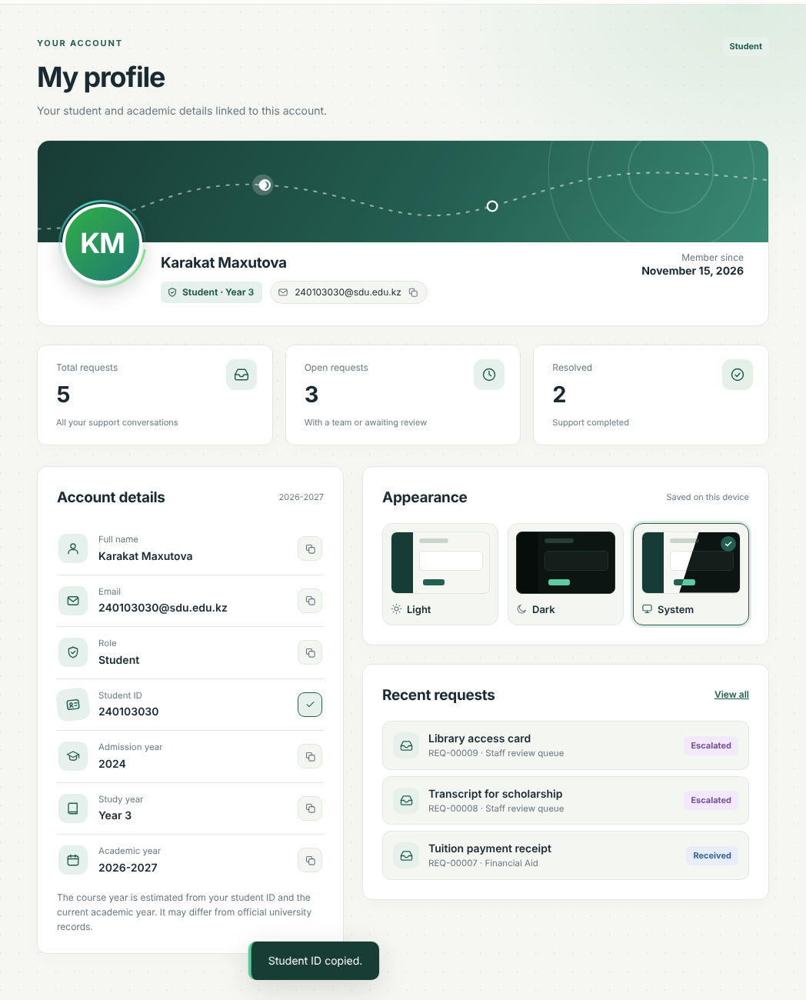
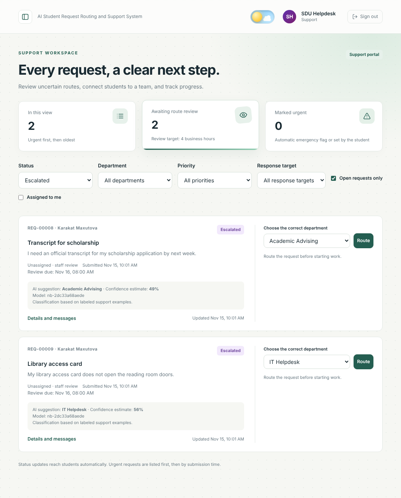
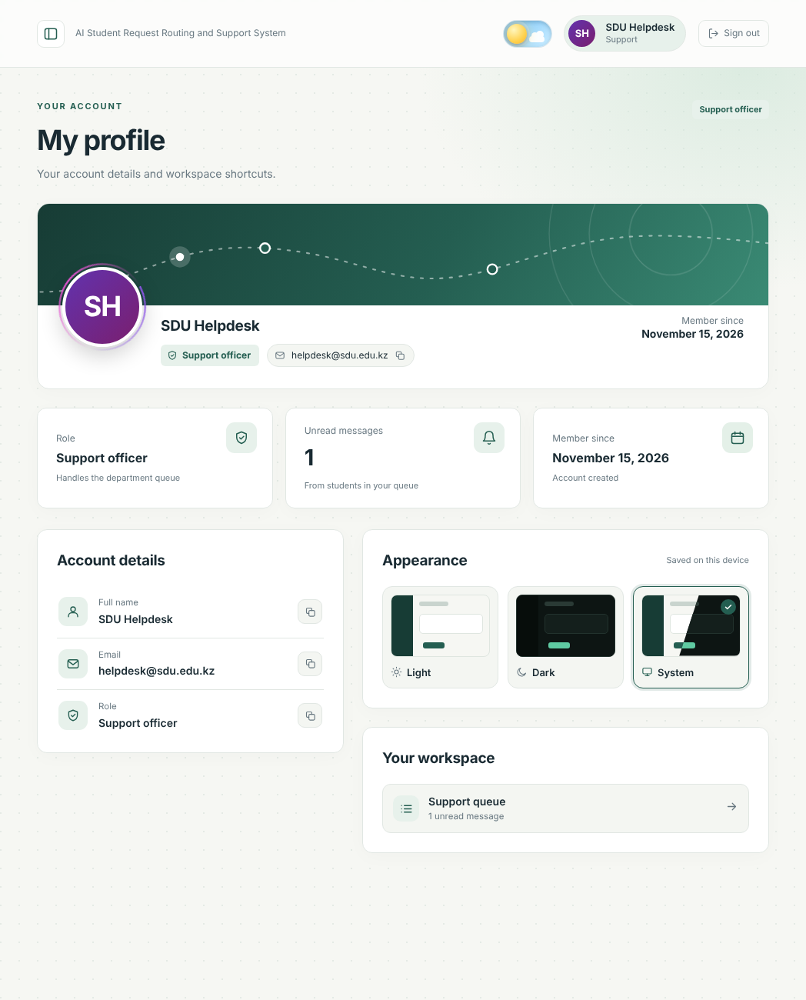

# Sprint 5 report

**Project:** AI Student Request Routing and Support System  
**Increment:** Student request search and filters, request message threads, a student profile panel, and pressable summary cards and profile rows  
**Duration:** Two weeks (01.11.2026 to the sprint deadline 15.11.2026), as required by the lab sheet  
**Source scope:** US10, US11, and US12, 11 total source effort points  
**Readiness:** Implemented increment; backend suite and browser check re-run 15.11.2026, see Acceptance and testing  
**Human acceptance:** Not recorded; actual team/teacher acceptance must be recorded after the defence

## Sprint goal

Let a student find any past request quickly, clarify missing details with the support staff member handling it without opening a new request, and see which student identity and study year the system uses. Make the summary cards and profile details pressable, so that one press jumps to the matching list or copies the value.

## Planning and selected backlog

| Story | Source effort | Owner role | Dependency | Completion evidence |
| --- | --- | --- | --- | --- |
| US10. Student request search and filters | 3 | Frontend Developer and UX Designer | Signed-in student, own request history, server-enforced ownership | Search, status and department filters, clear, empty state; owner-only list endpoint |
| US11. Student-staff messaging on a request | 5 | Full-stack Developer and UX Designer | US5 status, US4 staff dashboard, US2 notifications | 19 messaging tests: access control, ordering, read state, notices, limits |
| US12. Student profile panel | 3 | Frontend Developer and UX Designer | Signed-in student, server-returned profile | Profile derivation tests (12); browser check of the profile page and pressable rows |

The team's deadline for Sprint 5 is 15.11.2026, recorded in the product backlog and the revised workbook for US10, US11, and US12. It is a planning date, not evidence of completed course work. The course roadmap assigns US10-US12 to Sprint 5 (Sprint 4 holds US8-US9, Sprint 6 holds US13-US14). The task breakdown is in `sprint_5/backlog.csv`.

## Increment delivered

**US10 - Search and filters**

- Search box over reference, subject, message text and department name, case-insensitive.
- Status filter (Received, In Progress, Escalated, Resolved) and department filter, including a "Staff review" option for requests not yet routed; both combine with the search.
- Clear-filters button, a live "Showing X of Y requests" count, and a distinct empty state when nothing matches.
- Filters are kept when the list refreshes every 15 seconds and reset on sign-out.
- Filtering runs in the browser over the student's own list; the server returns only requests owned by the signed-in student.

**US11 - Messaging on a request**

- Message thread in the request details dialog, open to the request owner and support staff only. Another student receives the same 404 as for a missing request; administrators receive 403.
- Messages of 1-1000 characters, at most 300 per thread. The sender role comes from the session, so a client cannot forge it.
- Retry-safe sending through a client identifier: a double click or lost response does not duplicate a message.
- The thread becomes read-only when the request is Resolved (HTTP 409) and writable again after reopening. Escalated requests can be clarified before they are routed.
- Unread counts for both sides, mark-as-read, and polling with an `after` position that returns only new messages. The support queue shows the unread total.
- Each staff message creates exactly one in-app notification for the student, without copying the text; refresh does not duplicate it. Staff messages are written to the audit log.
- Messages never change the request version or the status timeline, are never sent to the AI classifier, and are deleted with their request.

**US12 - Student profile panel**

- "My profile" page at `/profile`, reachable from the sidebar and by clicking the account name in the top bar. It shows full name, SDU email, role, member-since date, and for students the student ID, admission year, study year and academic year.
- Student values are derived from the nine-digit student ID; the academic year changes on 1 September at UTC+5. Example: the 24-prefix is admission year 2024, Year 3 in 2026-2027.
- A visible note states that the course year is an estimate and may differ from official university records.
- Beyond the story: the page also shows the student's request counts and three most recent requests, a copy-email button, and a Light / Dark / System theme choice saved on the device. Support and administrator accounts now get the same page with their role details and workspace shortcuts. The session user now includes the account creation date for the member-since field.

**Pressable cards and rows (US10 and US12)**

- On the student home and on the profile, the **Total**, **Open** and **Resolved** cards open the request list with that status filter applied. The status filter has a new **Open** value (every request that is not Resolved). If the student is already on the home page, the filters change without re-rendering the form, so a half-written request is not lost.
- In the support queue, **In this view** clears the queue filters, **Awaiting route review** filters on Escalated, and **Marked urgent** filters on Urgent priority.
- Every row in **Account details** (name, email, role, student ID, admission year, study year, academic year) is a button: pressing anywhere on the row copies the value, shows a confirmation, and briefly turns the icon into a tick. Role and member-since cards copy their value.
- On the support profile the **Unread messages** card opens the support queue; on the administrator profile the **Access** card opens routing settings.
- The cards are real buttons or links, so they can be reached with the keyboard and show a focus ring.

## Acceptance and testing

Executed on 15.11.2026 with Python 3.12 (`python3 -m unittest discover -s tests`, local mode):

| Check | Result | Boundary |
| --- | --- | --- |
| US11 messaging suite (`test_messaging`) | 19 passed | Ownership, role, concurrency, retries, read-only, notices, limits, classifier isolation |
| Profile and SDU rules (`test_university`) | 12 passed | Admission year, course, 1 September rollover, forged-field rejection |
| Full backend suite | 163 run, 163 passed | Includes two older tests updated this sprint, see below |
| Sprint 5 browser check (`scripts/sprint5_ui_check.py`) | 17 of 17 passed | Chromium, clean demo database, local classifier: US10 filters and search, US11 thread, US12 profile for three roles, pressable cards and rows, copy to clipboard, no overflow at 390x844 |
| Older Node browser checks (`browser_checks.mjs`) | Not run | Playwright for Node is not installed here |

Two older tests no longer matched the code and were updated: the schema test now expects the current 22 tables, and the urgency test now expects the fixed alert text "Missed emergency reported by student." The student's free-text note in a missed-emergency report is accepted but is not copied into the alert, and the test now asserts that. The Sprint 5 browser check is not part of the GitHub workflow yet, because it needs Chromium.

## Sprint review / demo

1. Sign in as a student with several requests in different statuses and departments.
2. Press the Open requests card and show the filtered list; press Total to clear it. Then search by reference and by a word from a message; combine with the status and department filters; clear them.
3. Open a request, show the message thread, and send a clarification question.
4. Sign in as support, open the same request, see the unread count, and reply.
5. Return to the student: show the single notification and the reply; mark the thread read.
6. Resolve the request to show the thread turn read-only, then reopen it and send again.
7. Sign in as a second student and show that the first student's requests and thread are not reachable.
8. Open My profile and show student ID, admission year, academic year and estimated course; press the Student ID row to copy it; press the Resolved card to jump to the filtered list; switch the theme; sign in as support, press Awaiting route review in the queue, and show the role-based profile.

This is a prepared review sequence. It is not evidence that a Product Owner attended or approved a meeting.

## Technical retrospective

What worked: access control is decided in one place before the messaging module is reached, so owner, support and administrator rules are tested together. A client identifier makes sending safe to retry, and keeping message text out of notices and the classifier limits privacy exposure. Deriving the profile from the student ID avoids a second source of truth.

Challenges: search and filters run in the browser, so they are covered only by the browser check, which is outside the automated backend suite and the GitHub workflow. The profile page grew beyond the story (all roles, themes, activity panel). A first version of the copy rows passed a scripted click on the button but failed with a real mouse press: a press-down animation shrank the invisible layer that makes the whole row clickable, so the click never reached the button. The browser check found it and the animation was removed. Test names in `test_retraining.py` use "US10" for the retraining pipeline of the earlier story numbering, which can be confused with the current US10 search story.

Action items: add the Sprint 5 browser check to the GitHub workflow with Chromium; re-run the older Node browser checks; rename the retraining test labels; record the actual review, retrospective and acceptance outcomes.

## Current boundary

US13-US16 (response-time reminders, attachments, audit log, retention and deletion) are outside this sprint. The course year in the profile is an estimate from the ID, not an enrollment lookup, and the profile is read-only; support and administrator profiles show no academic data. Messages are short plain text with no attachments or editing. Pressable cards only filter or navigate; they do not change data.

## Evidence

Evidence screenshots

Captured on 15.11.2026 from a local run with synthetic demo data (local classifier, not Gemini) by the same flow as `scripts/sprint5_ui_check.py`. Results are in `evidence/sprint5_ui_check.json`; the original images are in `evidence/sprint5/`.

